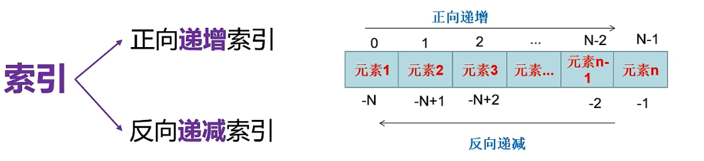
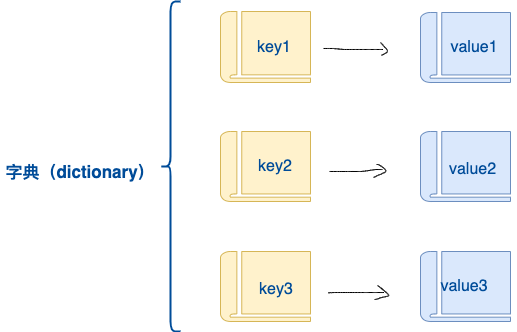

## Python 核心数据结构——让数据管理井井有条
**驱动问题**：我们要实现一个“班级成绩管理系统”，需要存储学生姓名、各科成绩，实现增删改查、排序、去重、统计等功能。面对一堆数据，如何选择最合适的容器？Python 提供了六种核心数据结构：数字、字符串、列表、元组、集合、字典。学完本模块，你不仅能扎实掌握它们的特性与方法，还能真正理解“在什么场景下用哪种结构”。

---

### 1. 数字类型 (Number) —— 计算的基石
Python 内置四种数字类型：`int`（整数）、`float`（浮点数）、`bool`（布尔值）、`complex`（复数）。其中前三种最常用。

#### 1.1 整数 int：无限大，有小整数池
+ Python 3 中整数**没有大小限制**，理论上可以表达任意大的数。
+ **小整数池**：[-5, 256] 范围内的整数，解释器会预先创建并复用，以优化内存。因此不同变量赋相同小整数时，可能指向同一对象。

```python
a = 10
b = 10
print(a is b)   # True （小整数池复用）
c = 1000
d = 1000
print(c is d)   # 可能为 False（超出范围，一般不会复用）
```

#### 1.2 浮点数 float：精度陷阱与正确比较
二进制无法精确表示某些十进制小数，导致 `0.1 + 0.2 != 0.3`。

```python
print(0.1 + 0.2)                  # 0.30000000000000004
print(round(0.1 + 0.2, 2) == 0.3) # True，借助 round 粗略比较

# 专业做法：使用 math.isclose (Python 3.5+)
import math
print(math.isclose(0.1 + 0.2, 0.3))  # True
```

**特殊值**：`float('inf')` 正无穷，`float('-inf')` 负无穷，`float('nan')` 非数。

#### 1.3 布尔值 bool：整数子类，短路运算
+ `True` 等价于 `1`，`False` 等价于 `0`，可参与算术运算。
+ 逻辑运算符 `and` / `or` 采用**短路求值**：
    - `x and y`：若 `x` 为假直接返回 `x`，否则返回 `y`。
    - `x or y`：若 `x` 为真直接返回 `x`，否则返回 `y`。

```python
print(True + 1)          # 2
print(3 and 0)           # 0（遇假则停）
print(0 or 'hello')      # 'hello'（遇真则停）
```

#### 1.4 类型转换与数学函数
+ 显式转换：`int(x)`、`float(x)`、`complex(x)`。
+ 隐式转换：混合运算时 `int -> float -> complex` 自动提升。

常用数学函数（需 `import math`）：

| 函数 | 说明 | 示例 |
| --- | --- | --- |
| `abs(x)` | 绝对值 | `abs(-3)` → `3` |
| `math.ceil(x)` | 向上取整 | `ceil(4.1)` → `5` |
| `math.floor(x)` | 向下取整 | `floor(4.9)` → `4` |
| `round(x, n)` | 四舍五入到n位小数 | `round(3.1415, 2)` → `3.14` |
| `pow(x, y)` | x 的 y 次方 | `pow(2, 3)` → `8` |
| `math.sqrt(x)` | 平方根 | `sqrt(16)` → `4.0` |
| `bin(x)` / `hex(x)` / `oct(x)` | 进制转换 | `bin(10)` → `'0b1010'` |

---

### 2. 字符串 (String) —— 文本处理专家
字符串是**不可变**的 Unicode 字符序列，支持索引、切片、丰富的内置方法。

#### 2.1 定义与基本操作
+ 单引号 `'...'`、双引号 `"..."`、三引号 `'''...'''`（多行）。
+ 索引从 0 开始，负数从末尾开始；`s[0]`，`s[-1]`。
+ 切片 `[start:end:step]`，左闭右开，步长可正可负。



```python
text = "Python编程"
print(text[0])          # P
print(text[-1])         # 程
print(text[::])         # 省略所有参数，取整个字符串
print(text[1:])         # 省略end参数，默认到尾元素
print(text[:6])         # 省略start参数，默认从首元素开始
print(text[::2])       
print(text[::-1])       # 逆序整个字符串

# 使用正序取字符串 和 倒序取字符串，可以取判断是否是回文字符串
# 什么是回文字符串？正着读和倒着读一样的字符串。比如：aabaa  abcba就是
input_str = input("请输入一个字符串：")
print(f"{input_str}是回文字符串吗？{input_str[::] == input_str[::-1]}")

```

#### 2.2 常用方法速查（务必掌握）
| 方法 | 说明 | 示例 |
| --- | --- | --- |
| `len(s)` | 返回长度 | `len("ab")` → `2` |
| `s.find(sub)` | 查找子串索引，找不到返回 -1 | `"hello".find("l")` → `2` |
| `s.index(sub)` | 查找子串索引，找不到报错 | `"hello".index("e")` → `1` |
| `s.count(sub)` | 子串出现次数 | `"ababa".count("a")` → `3` |
| `s.lower()` / `s.upper()` | 大小写转换 |  |
| `s.strip()` | 去除首尾空白 | `" hi ".strip()` → `"hi"` |
| `s.replace(old,new)` | 替换 | `"ab".replace("a","b")` → `"bb"` |
| `s.split(sep)` | 按分隔符切分，返回列表 | `"a,b".split(",")` → `['a','b']` |
| `sep.join(iterable)` | 用分隔符合并序列 | `",".join(['a','b'])` → `"a,b"` |
| `s.startswith(prefix)` | 是否以某前缀开头 | `"hello".startswith("he")` → `True` |
| `s.isdigit()` / `s.isalpha()` | 是否全为数字/字母 |  |
| `f"{变量:格式}"` | **f-string 格式化** (推荐) | `f"{3.14:.1f}"` → `"3.1"` |

```plain

```

**演示说明**

```python
print(len("abcd"))
print("学AI找icecola".find("icecola"))
# print("学AI找icecola".index("icecolaa")) # ValueError: substring not found
print("学AI找icecola".replace("icecola", "冰可乐"))
print("aaaaaaaaabbbbb".count("a", 2, 5))
print("学AI，找冰可乐，不踩坑".split("，", maxsplit=1))
print("_".join("abcdef"))
```

**应用**：提取 URL 中的用户名和密码

```python
url = "http://www.example.com?userName=admin&pwd=123456"
query = url.split("?")[1]          # "userName=admin&pwd=123456"
params = query.split("&")
user = params[0].split("=")[1]     # "admin"
pwd  = params[1].split("=")[1]     # "123456"
print(f"用户名: {user}, 密码: {pwd}")
# 这里主要使用了分割方法，并且要注意以分隔符分割多个元素之后，可以使用索引进行对应取值
```

#### 2.3 额外补充：字符串不可变与高效拼接
+ 每次修改字符串实际上会创建新对象，循环中大量拼接请用 `str.join()` 或 `io.StringIO`，避免 `+` 操作带来的性能浪费。

```python
text = "iceColaAI"    # 想将 C 修改为 c
# text[3] = 'c'       # TypeError: 'str' object does not support item assignment
# print(text)

text.replace('C', 'c')
print(text)     # iceColaAI
replaced_text = text.replace('C', 'c')
print(replaced_text)    # icecolaAI

print('a' + '-' + 'b' + '-' + 'c')
print('-'.join("abc"))
```

---

### 3. 列表 (List) —— 灵活的有序容器
列表是**可变**、**有序**、可重复的集合，用方括号 `[]` 定义。它是日常开发中使用频率最高的数据结构。  
注意：这里的有序核心指：元素的插入顺序会永久保留，且每个元素都有固定的位置（索引）。简单的说：你按什么顺序放进去，取出来就是什么顺序，不会乱序，不会自动排序。  
列表名称 = [元素1, 元素2, 元素3.....]

和C语言数组不一样的是：列表可以异构，也就是存储不同数据类型的元素。

#### 3.1 增删改查基本功
```python
fruits = ['apple', 'banana']

# 增加
fruits.append('cherry')             # 尾部添加
print(fruits)
fruits.insert(1, 'blueberry')       # 指定位置插入
print(fruits)
fruits.extend(['mango', 'grape'])   # 合并另一个列表
print(fruits)

# 修改
fruits[0] = 'strawberry'
print(fruits)

# 查询
print('apple' in fruits)            # False
print('apple' not in fruits)        # True
print(fruits.index('cherry'))       # 首次出现的索引
print(fruits.count('apple'))        # 出现次数

# 删除
fruits.remove('banana')             # 按值删除（第一个匹配项）
print(fruits)
popped = fruits.pop(1)              # 按索引删除并返回该元素，未指定索引时删除尾元素
print(f"{popped}被删掉了")
del fruits[0]                       # 通用删除语句
print(fruits)
fruits.clear()                      # 清空
print(fruits)
del fruits
# print(fruits)                       # NameError: name 'fruits' is not defined

```

#### 3.2 排序
+ `list.sort(key=None, reverse=False)` 原地排序，无返回值。
+ `sorted(iterable, key=..., reverse=...)` 返回新列表，原列表不变。

```python
numbers = [3, 1, 4, 1, 5]
# 使用独属于列表的排序方法
numbers.sort()                # [1, 1, 3, 4, 5]
print(numbers)
numbers.sort(reverse=True)
print(numbers)

nums = [3, 1, 4, 1, 5]
# 使用python内置的独立的排序方法
new_nums = sorted(nums, reverse=True)
print(nums) # [3, 1, 4, 1, 5]
print(new_nums)

```

**按自定义规则排序**（如按字符串长度）：

```python
words = ["apple", "banana", "kiwi"]
words.sort(key=len)           # ['kiwi', 'apple', 'banana']
```

#### 3.3 切片与复制
+ 切片生成新列表：`new_list = old_list[:]` 实现**浅拷贝**。
+ 直接赋值只是引用传递（理解引用就是原文件的快捷方式），两个变量指向同一对象。

```python
ls1 = ["icecola", ["AI", "python"], "LLM"]
# 直接赋值
ls2 = ls1
print(ls1, "VS", ls2)
# 分别修改两个的值，再对比
ls1[0] = "ICECOLA"
ls2[-1] = "Qwen"
print(ls1, "VS", ls2)
print(ls1 is ls2)

ls3 = ls1[0:2]
print(ls3, "VS", ls1)
ls3[0] = 'ByeBye'
print(ls3, "VS", ls1)
ls3[1][0] = 'Transformer'
print(ls3, "VS", ls1)
print(ls3 is ls1)
```

#### 3.4 深拷贝与浅拷贝
+ **浅拷贝**：`copy.copy()` 或 `list.copy()`，只复制容器本身，内部的**可变对象**仍共享。
+ **深拷贝**：`copy.deepcopy()`，递归复制所有层级，完全独立。

```python
import copy
original = [1, 2, [3, 4]]
shallow = original.copy()         # 浅拷贝
deep = copy.deepcopy(original)    # 深拷贝

original[2][0] = 'X'
print(shallow)   # [1, 2, ['X', 4]]  内部列表被影响
print(deep)      # [1, 2, [3, 4]]    完全独立
original[0] = 'icecola'
print(shallow) 
print(deep)
```

#### 3.5 嵌套列表与多维数据处理
```python
menu = [['红烧牛肉面', 18], ['香辣牛肉面', 20], ['重庆小面', 15]]
print(menu[0])
print(menu[0][0])
# print(menu[0, 0])   # TypeError: list indices must be integers or slices, not tuple

# 按价格排序
# import operator
# menu.sort(key=operator.itemgetter(1), reverse=True)
# print(menu)

# 匿名函数
menu.sort(key=lambda x:x[1], reverse=True)
print(menu)
```

---

### 4. 元组 (Tuple) —— 不可变的记录
元组是**不可变**的有序序列，用圆括号 `()` 定义。适合存放结构化数据（如坐标、数据库记录）。

#### 4.1 特性与创建
+ 不可变：元素不能修改、添加或删除，但内部可变对象的内容可改。
+ 单元素元组必须加逗号：`t = (42,)`，否则 `(42)` 只是带括号的数字。

```python
s, l, t = "", [], ()
print(type(s), type(l), type(t))

s, l, t = "1", [1], (1,)
print(type(s), type(l), type(t))

point = (3, 4)
print(point[0])    # 3

# 内部包含列表时可修改列表内容
t = (1, [2, 3])
# t[0] = 66   # TypeError: 'tuple' object does not support item assignment
t[1].append(4)
print(t)           # (1, [2, 3, 4])
```

#### 4.2 元组解包 (Unpacking)
```python
x, y = (10, 20)
print(x, y)   # 10 20

# 多变量交换
a, b = 1, 2
a, b = b, a        # 一行交换，本质是元组打包和解包
print(a, b)
a, b, c = 1, 2, 3
a, b, c = c, a, b
print(a, b, c)
```

#### 4.3 命名元组（进阶但实用）
`collections.namedtuple` 可以让元组像简单类一样使用属性名访问字段，提高可读性。

```python
from collections import namedtuple
Student = namedtuple('Student', ['name', 'score'])
s1 = Student('Alice', 90)
print(s1.name, s1.score)
```

---

### 5. 集合 (Set) —— 去重与集合运算
集合是**无序、不重复**的元素集合，用 `{}` 或 `set()` 定义。注意：`{}` 是空字典，空集合必须用 `set()`。

#### 5.1 基本操作与去重
```python
data = [1, 2, 2, 3, 3, 3]
unique = set(data)         # {1, 2, 3}
print(unique)
print(list(unique))        # 转回列表
```

#### 5.2 集合运算（交、并、差、异或）
```python
a = {1, 2, 3}
b = {2, 3, 4}
print(a & b)   # 交集 {2, 3}
print(a | b)   # 并集 {1, 2, 3, 4}
print(a - b)   # 差集 {1}  （a有b无）
print(a ^ b)   # 异或集 {1, 4} （只在其中一边出现）
```

#### 5.3 一些成员身份的判断
经理：曹操，刘备，孙权；技术员：曹操，孙权，张飞，关羽。求：

1. 既是经理也是技术员的
2. 是技术员但不是经理的
3. 张飞是经理吗？
4. 身兼一职的人（只在一个集合中）

```python
managers = {'曹操', '刘备', '孙权'}
techs = {'曹操', '孙权', '张飞', '关羽'}

print("1. 既是经理也是技术员:", managers & techs)
print("2. 是技术员但不是经理:", techs - managers)
print("3. 张飞是经理吗?", '张飞' in managers)
print("4. 身兼一职的人:", managers ^ techs)   # 异或集
```

---

### 6. 字典 (Dict) —— 键值对映射
字典是 Python 中最强大的数据结构之一，用于存储键值对（`key: value`）。键必须**不可变**且唯一，值可以是任意对象。



#### 6.1 创建与基本操作
```python
s, l, t, d = "", [], (), {}
print(type(s), type(l), type(t), type(d))

student = {
    'name': 'Alice',
    'age': 20,
    'courses': ['Math', 'Physics']
}
print(student)
# print(student[0])   # KeyError: 0，字典是按键索引值的，不像列表/元组/字符串是按照index索引值

# 增/改
student['grade'] = 'A'         # 新增
print(student)
student['age'] = 21            # 修改
print(student)

# 删除
age = student.pop('age')       # 删除并返回值
print(student)
# student.pop("icecola")    # KeyError: 'icecola'
del_content = student.pop("icecola", "没找到你想删除的key")
print(del_content)
student.clear()                # 清空
print(student)
```

#### 6.2 安全访问
```python
student = {
    "name": "冰可乐",
    "age": 20
}
# 直接访问可能引发 KeyError
# print(student['gender'])            # 报错

# 推荐使用 get
print(student.get('gender'))        # None
print(student.get('gender', '未知')) # 未知
```

#### 6.3 遍历与视图
```python
# 获取所有key
print(student.keys())
# 获取所有value
print(student.values())
# 获取所有 key:value
print(student.items())
```

#### 6.4 合并与更新（Python 3.9+ 运算符）
```python
d1 = {'a': 1, 'b': 2}
d2 = {'c': 3, 'd': 4}
merged = d1 | d2           # 合并为新字典
print(d1)
print(d2)
print(merged)
d1 |= d2                   # 就地更新（d1 被修改）
print(d1)
print(d2)
```

#### 6.5 进阶补充（预告）
+ `collections.defaultdict`：处理缺失键时自动初始化。
+ `collections.Counter`：统计计数。
+ 这些将在后续数据处理章节深入使用。

```python
# 输入一个字符串，统计每个字符出现的次数。
input_str = input("请输入一个字符串：")
import collections
print(collections.Counter(input_str))

student = collections.defaultdict(lambda: None)
student["age"] = 20
student["name"] = "冰可乐"
print(student)
print(student["sex"])
```
